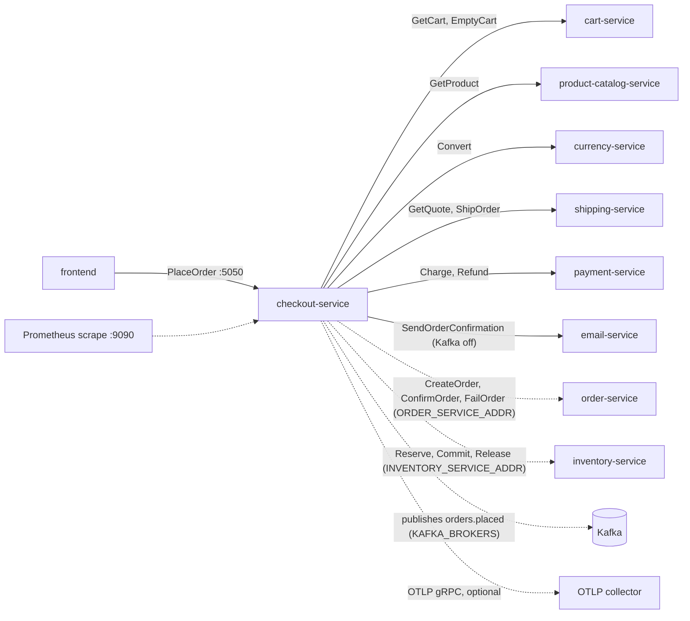

# Architecture

## Context



Dotted arrows are optional: they exist only when the matching environment variable is set. checkout-service holds no state of its own. The callers and the optional services are read from `cmd/server/main.go` (which dials them) and `internal/checkout/`.

## Main flow: `PlaceOrder`

All steps and their error codes are in [API](api.md); this is the shape of the saga (every optional step is skipped when its variable is unset).

```mermaid
sequenceDiagram
    participant FE as frontend
    participant CO as checkout-service
    participant OR as order-service
    participant IN as inventory-service
    participant PA as payment-service
    participant SH as shipping-service
    participant K as Kafka
    FE->>CO: PlaceOrder
    Note over CO: validate, cart, prices, quote (no side effects)
    CO->>OR: CreateOrder (PENDING)
    CO->>IN: Reserve (all or nothing)
    CO->>PA: Charge
    CO->>SH: ShipOrder
    CO->>IN: Commit (3 attempts)
    CO->>K: orders.placed (5 s bound, best effort)
    CO->>OR: ConfirmOrder (PLACED, 3 attempts)
    Note over CO: empty cart; email only when Kafka is off
    CO-->>FE: OrderResult
```

Failure after the charge: a failing `ShipOrder` triggers `Refund`, then `Release` of the stock, then `FailOrder`. A failing `Charge` triggers `Release` and `FailOrder`. These compensations run on a context detached from the caller (`context.WithoutCancel`) so a caller that gave up does not leave stock reserved or an order `PENDING`. Compensation is best effort, see [Known limitations](limitations.md) and [ADR 1](adr/0001-saga-with-best-effort-compensation.md).

## Components

| File | Role |
|---|---|
| `cmd/server/main.go` | listen, dial the downstream services (lazy `grpc.NewClient`), optional order/inventory/Kafka wiring, health service, reflection, graceful drain |
| `internal/checkout/service.go` | `PlaceOrder`: validation, pricing, the saga in order |
| `internal/checkout/orders.go` | order storage steps (`CreateOrder`, `ConfirmOrder`, `FailOrder`) and the limits of order-service checked up front |
| `internal/checkout/inventory.go` | stock saga (`Reserve`, `Commit`, `Release`) |
| `internal/checkout/idempotency.go` | order id from the `idempotency_key` (UUIDv5), replay of a stored order, in-process guard against a concurrent twin |
| `internal/checkout/events.go`, `kafka.go` | the `orders.placed` event and the franz-go producer |
| `internal/checkout/deadlines.go`, `errors.go`, `recovery.go`, `saga_trace.go` | per-call deadlines, mapping of downstream codes, panic recovery interceptor, one span per saga step |
| `internal/healthcheck/` | the `healthcheck` subcommand used by the image `HEALTHCHECK` |
| `internal/money/` | Money arithmetic |
| `internal/obs/` | telemetry, log shape, metrics server (same package in every Go service) |
| `proto/` | `checkout.proto` plus vendored contracts of order- and inventory-service in their own Go packages |

## Contracts

The proto package is `hipstershop` (legacy name, see [ADR 2](adr/0002-legacy-proto-package-hipstershop.md)). Changes are additive only, server first.
